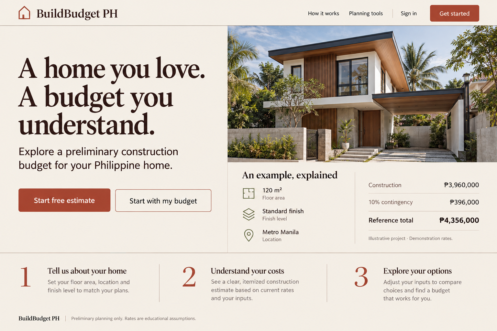
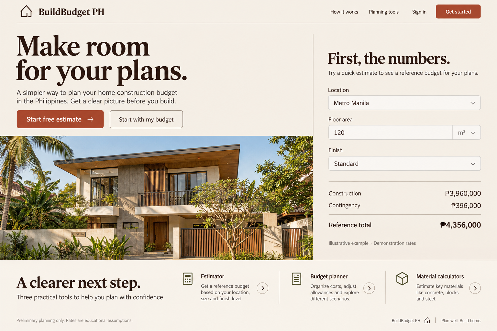
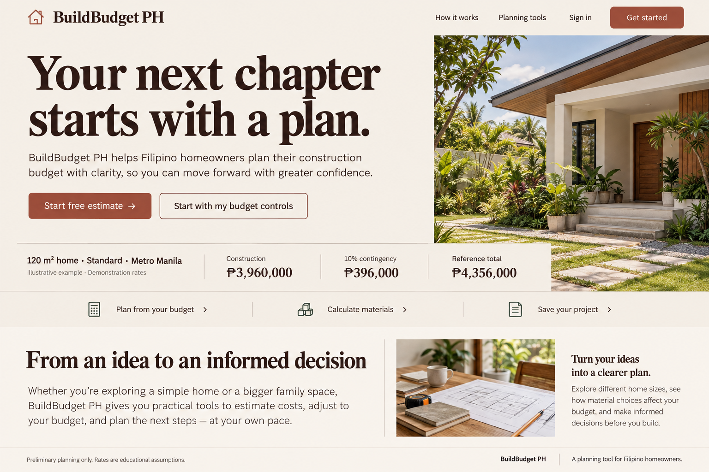

# BuildBudget PH redesign mockups

These are visual proposals for the Planning journal direction: warm paper, terracotta, editorial headings, and a welcoming homeowner planning experience.

Choose **1, 2, or 3** in the chat. The working website has not yet been visually redesigned. Option **2** is recommended for its clear budget form.

The images are generated mockups. During implementation, wording will be corrected to match the product: rates are educational demonstration assumptions, and the materials toolkit covers concrete, hollow blocks, tiles, paint, and roofing. The house imagery is illustrative.

## 1. Open notebook

A welcoming introduction beside an illustrated home and an explained budget example.

[Open full-size image](01-open-notebook.png)

## 2. Project desk — recommended

A large editorial headline and house image beside a practical planning form.

[Open full-size image](02-project-desk.png)

## 3. Build story

An editorial introduction, tall house image, and horizontal budget summary.

[Open full-size image](03-build-story.png)
